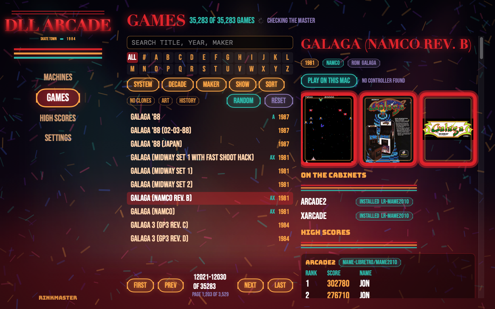
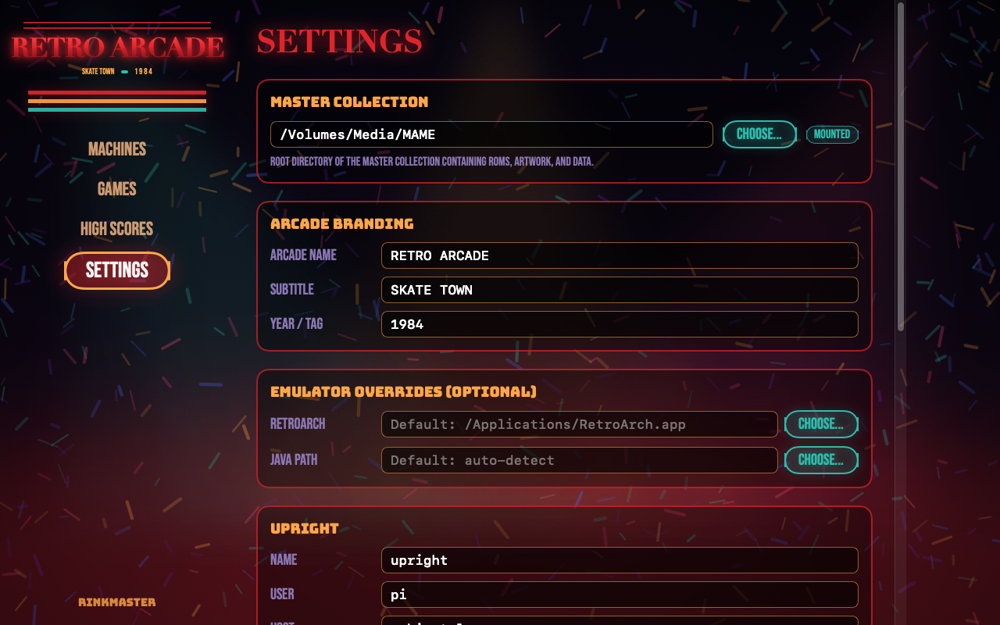
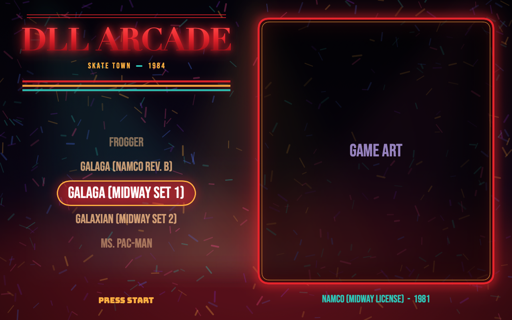

# RinkMaster

<p align="center">
  
</p>

**RinkMaster** is a native macOS application for managing networked RetroPie arcade cabinets and local emulators from one central dashboard. Wrapped in a 1980s retro roller-rink neon aesthetic, RinkMaster unifies your arcade cabinets, master ROM collection, high scores, and local play into a single management center.

---

## Purpose

Managing multiple arcade machines (cocktail tables, upright cabinets, tanksticks) often requires manual SSH sessions, scattered ROM folders, and isolated high-score tables.

RinkMaster solves this by providing:

1. **Master Catalog Browser:** Search and browse your entire master collection with flyers, marquees, title snapshots, and arcade history across 30,000+ games.
2. **Centralized Cabinet Inventory:** See every installed game across all your cabinets, organized by system and emulator core (Attract-Mode, EmulationStation, lr-mame2003, lr-mame2010, lr-mame2016, Stella, etc.).
3. **One-Click Install & Remove:** Push games, required parent ROMs, BIOS, and artwork directly from your master ROM archive (on a NAS or local disk) to any cabinet over SSH/HTTP, or remove games cleanly without touching your master archive.
4. **Unified High Scores:** Automatically collect high-score files (`.hi`, `.nv`) from all your cabinets, decode score tables across different MAME core formats, find the reigning champions, and synchronize the best scores across all machines.
5. **Play on Mac:** Launch games locally on your Mac using MAME or RetroArch directly from the detail view, pre-staging winning arcade high scores so you can compete against your cabinets.
6. **Configurable Arcade Branding:** Personalize the header with your own arcade title, subtitle, and year/tagline to match your personal arcade setup.
7. **Cabinet Theme Installation:** Install and activate matched arcade themes directly from the app, MCP, or CLI (supporting `dll-arcade` for EmulationStation and `rink` for Attract-Mode).
8. **Built-in Model Context Protocol (MCP) Server:** Allows AI assistants (Claude Code, Antigravity, Codex) to inspect machine inventories, search games, plan game installs, install themes, and query high scores via stdio.

---

## Screenshots

| Master Game Browser & Detail | Setup & Arcade Branding |
|:---:|:---:|
|  |  |

| 1980s Roller-Rink Theme Preview |
|:---:|
|  |

---

## Prerequisites

- **macOS 14 (Sonoma) or later** (Apple Silicon or Intel).
- **Xcode 15+** or **Swift 6+ command-line tools** (`xcode-select --install`).
- **One or more RetroPie cabinets** reachable over your local network via passwordless SSH.
- **A Master Collection folder** containing your ROMs and artwork (on a local drive, external disk, or mounted NAS share).

---

## Build & Installation

### Step 1: Clone the Repository

```bash
git clone https://github.com/johndolljr/RinkMaster.git
cd RinkMaster
```

### Step 2: Build the Application

You can build RinkMaster using either standard SwiftPM or the provided build script:

```bash
# Using standard Swift Package Manager
swift build

# Or using the build script (Debug by default, or Release for optimized binary)
scripts/build.sh [Debug|Release]
```

To run all unit tests and verify coverage:
```bash
scripts/test.sh
```

### Step 3: Install to Applications

Run the install script to compile the release build, assemble the custom fonts, embed the MCP server, code-sign, and install the `.app` bundle into `~/Applications`:

```bash
scripts/install.sh
```

Launch the app from `~/Applications/RinkMaster.app` or run it from the terminal:
```bash
scripts/run.sh
```

---

## Initial Setup Walkthrough

When launching RinkMaster for the first time with an unconfigured setup, the app guides you directly to the **Settings** view:

### 1. Configure Master Collection
Click **CHOOSE...** under **MASTER COLLECTION** to select your master ROM/artwork directory (e.g. `/Volumes/Media/MAME` or your local folder). RinkMaster expects standard directory structure for sets (`roms/sets/<version>`, `roms/other-systems/<system>`, `artwork/best/<type>`).

### 2. Customize Arcade Branding
Under **ARCADE BRANDING**, personalize the header to match your arcade:
- **Arcade Name:** e.g., `RETRO ARCADE`
- **Subtitle:** e.g., `SKATE TOWN`
- **Year / Tagline:** e.g., `1984`

Your custom branding is dynamically displayed across the app's top neon banner.

### 3. Add Cabinets
Under **CABINETS**, click **ADD MACHINE**:
- **Name:** A friendly identifier (e.g. `upright`, `cocktail`).
- **Host:** Cabinet LAN hostname or IP address (e.g. `cabinet.lan`).
- **SSH User:** User on the cabinet (typically `pi`).
- **Frontend:** Choose `EmulationStation` or `Attract-Mode`.
- **Service Port:** Default is `8472`.
- Click **TEST CONNECTION** to confirm SSH and service reachability.

### 4. Optional Tool Overrides
Under **EMULATOR OVERRIDES (OPTIONAL)**, you can configure custom paths for:
- **RetroArch.app:** Custom path if installed in a non-standard location.
- **Java Home / Binary:** Custom Java runtime path if needed for `hi2txt` high-score decoding.

---

## Cabinet Service Setup (`rinkmasterd`)

Each cabinet can optionally run `rinkmasterd`, a lightweight Python daemon (using only the standard library) that provides fast cached inventory responses, safe game removals, and score downloads over HTTP:

```bash
service/install.sh USER@CABINET_HOST
```

*Example:*
```bash
service/install.sh pi@cabinet.lan
```

This sets up a systemd unit, enables it on boot, and verifies connectivity. If the service is not installed on a cabinet, RinkMaster automatically falls back to reading inventories and score files directly over SSH.

---

## Using the MCP Server

RinkMaster bundles `rinkmaster-mcp` inside the app bundle, allowing AI assistants to query inventories, search games, manage emulators, and inspect scores:

- **Path:** `~/Applications/RinkMaster.app/Contents/MacOS/rinkmaster-mcp`
- See [docs/MCP.md](docs/MCP.md) for full registration instructions with Claude Code, Codex, and Antigravity.

---

## Architecture & Design

For deeper technical details on module boundaries, high-score synchronization, and caching architecture, see [docs/ARCHITECTURE.md](docs/ARCHITECTURE.md).
